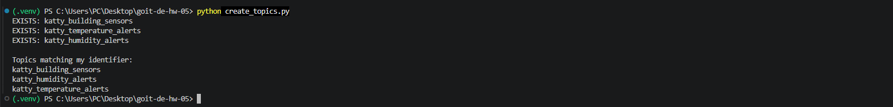
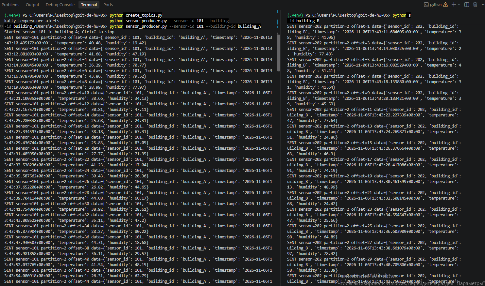
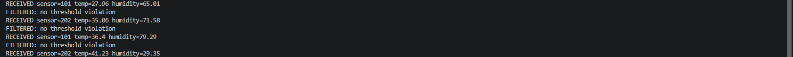
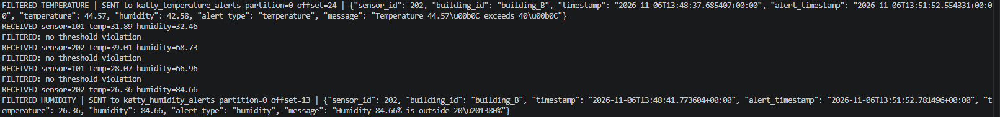
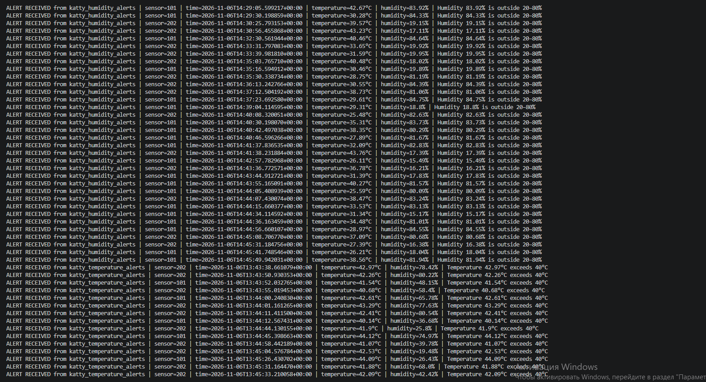

#GoIT Data Engineering HW05 — Kafka IoT Monitoring
#Project files
- `configs.py`: broker connection via local `.env` and topic names
- `create_topics.py`: create/list 3 topics
- `sensor_producer.py`: one sensor per running process
- `sensor_processor.py`: filter readings and send alerts
- `alert_consumer.py`: receive both alert streams
- `screenshots/`: capture the five required evidence screenshots
- `docs/`: complete the execution report with actual screenshots

#Setup (PowerShell, Windows)
```powershell
cd C:\Users\PC\Desktop\goit-de-hw-05
py -m venv .venv
.\.venv\Scripts\Activate.ps1
python -m pip install -r requirements.txt
notepad .env
```

#Run
```powershell
python create_topics.py
```
Open four separate terminals, activate the venv in each, and run in order:
```powershell
python alert_consumer.py
python sensor_processor.py
python sensor_producer.py --sensor-id 101 --building-id building_A
python sensor_producer.py --sensor-id 202 --building-id building_B
```
Each command above runs in its **own** terminal. Stop with Ctrl+C.

#Rules
- `temperature > 40` → `katty_temperature_alerts`
- `humidity > 80 or humidity < 20` → `katty_humidity_alerts`
- Normal readings generate no alerts.


# Objective
Implement an Apache Kafka-based system that generates simulated building sensor readings, processes incoming data, and publishes alerts when temperature or humidity exceeds defined thresholds.

# Implementation and Results

1. Kafka Topic Creation

Created three Kafka topics with a unique identifier: `katty_building_sensors`, `katty_temperature_alerts`, and `katty_humidity_alerts`.



2. Sensor Data Generation

Started two independent sensor producers (IDs 101 and 202), representing different buildings. Both producers continuously generated temperature readings between 25°C and 45°C and humidity readings between 15% and 85%, publishing them to the sensor topic.



3. Data Filtering

The Kafka processor consumed sensor messages and checked them against the defined thresholds. Normal readings were filtered out without generating alerts.



4. Alert Generation

The processor generated temperature alerts for readings above 40°C and humidity alerts for readings below 20% or above 80%. Alerts were successfully published to their corresponding Kafka topics.





5. Alert Consumption

The alert consumer subscribed to both alert topics and successfully displayed the received alerts, including sensor identifiers, timestamps, temperature, humidity, and alert messages.

Conclusion

The implementation successfully demonstrates Kafka-based data streaming with multiple producers, real-time filtering, separate alert topics, and a consumer receiving the generated alerts.
